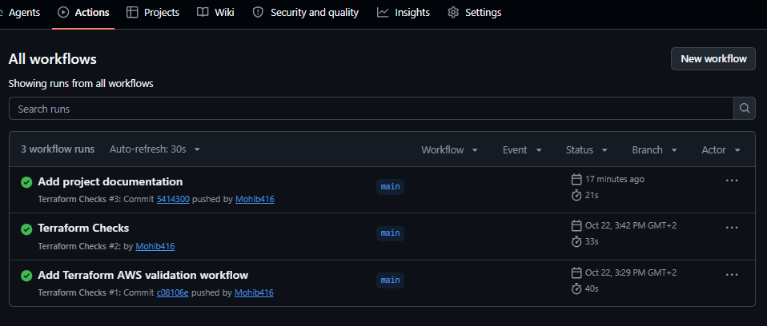

# Terraform AWS Lab

A beginner-friendly Terraform project that defines a basic AWS network
and uses GitHub Actions to automate configuration checks.

## Project Overview

This project demonstrates basic Infrastructure as Code (IaC) concepts
using Terraform and the AWS provider.

The configuration defines:

- An AWS Virtual Private Cloud (VPC).
- A subnet associated with the VPC.
- A security group associated with the VPC.
- Outputs for the resource identifiers.
- Automated Terraform checks using GitHub Actions.

## Technologies Used

- Terraform
- AWS Provider
- Git and GitHub
- GitHub Actions
- HCL

## AWS Configuration

The project is configured to use the AWS region `eu-south-1`
(Milan, Italy).

The network configuration includes:

| Resource | Configuration |
|---|---|
| VPC | `10.10.0.0/16` |
| Subnet | `10.10.1.0/24` |
| Security Group | Associated with the VPC |

This configuration does not explicitly declare ingress or egress rules
for the security group.

## Continuous Integration

The GitHub Actions workflow is located at:

`.github/workflows/terraform.yml`

It runs automatically on `push` and `pull_request` events.

The workflow performs three checks:

1. `terraform fmt -check -recursive`
2. `terraform init -backend=false -input=false`
3. `terraform validate -no-color`

These checks help identify formatting problems and invalid
Terraform configuration before infrastructure changes are considered.

## Run the Checks Locally

Install Terraform and make sure you have an internet connection
to download the required provider.

From the project directory, run:

```bash
terraform fmt -check -recursive
terraform init -backend=false -input=false
terraform validate -no-color
```

A successful validation should display:

`Success! The configuration is valid.`

## Safety and Scope

This is a learning project. The configuration has been validated
locally and through GitHub Actions.

**No AWS infrastructure has been deployed by this project so far.**

The workflow does not run `terraform plan` or `terraform apply`
and does not create AWS resources.

Before deploying infrastructure, review the Terraform plan,
AWS permissions, security settings, and potential costs.

Never commit AWS credentials, access keys, or other secrets
to a public repository.

## Project Status

- [x] Terraform configuration created
- [x] Terraform formatting and validation passed
- [x] Git repository configured
- [x] GitHub repository created
- [x] GitHub Actions workflow executed successfully
- [x] README documentation added
## CI/CD Evidence

GitHub Actions automatically checks Terraform formatting
and configuration on every push and pull request.



## Author

Mohib
